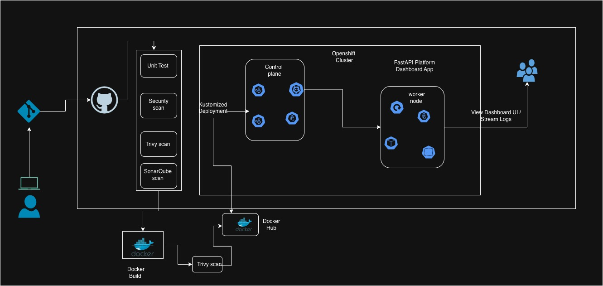

# OpenShift Platform Engineering: CI/CD, GitOps and Application Deployment


## Project Overview

This project demonstrates a cloud-native application delivery workflow built around **Red Hat OpenShift, Kubernetes, GitHub Actions, Docker, Quay.io, Kustomize and Argo CD**.

The goal is to explore how application code can be tested, packaged into a container image, scanned for vulnerabilities, stored in a container registry and deployed to an OpenShift environment.

The application is a Python Flask-based cryptocurrency dashboard. It exposes REST API endpoints for cryptocurrency information, historical price data, market statistics and application health.

The repository also includes Kubernetes deployment manifests, environment-specific Kustomize overlays, Argo CD application definitions and a separate MySQL deployment with Sealed Secrets configuration.

This project focuses on platform engineering practices such as repeatable deployments, declarative configuration, CI/CD automation, environment separation and container security.

## Architecture

The architecture diagram below illustrates the platform and application delivery design.



### Application delivery flow

1. A developer pushes application changes to GitHub.
2. GitHub Actions checks out the source code.
3. Python dependencies are installed and automated tests are executed.
4. Trivy is used to scan the repository for vulnerabilities.
5. Docker Buildx builds the application container image.
6. Trivy scans the container image.
7. The image is published to Quay.io.
8. The deployment workflow is intended to authenticate to the OpenShift API and deploy the application.
9. Kustomize provides reusable base manifests and environment-specific overlays.
10. Argo CD application definitions provide a GitOps deployment approach for development, staging and production.

## Technology Stack

| Technology | Role in the project |
|---|---|
| Python 3.12 | Application runtime |
| Flask | Web application and REST API |
| Pytest | Application testing |
| Docker | Containerization |
| GitHub Actions | CI/CD automation |
| Trivy | Filesystem and container vulnerability scanning |
| Quay.io | Container image registry |
| Kubernetes | Container orchestration |
| Red Hat OpenShift | Enterprise Kubernetes application platform |
| Kustomize | Reusable manifests and environment overlays |
| Argo CD | GitOps application delivery |
| Bitnami Sealed Secrets | Encrypted Kubernetes secret configuration |

## Repository Structure

```text
openshift-platform-engineering/
│
├── .github/
│   └── workflows/
│       └── docker-image.yml
│
├── Achitecturaldiagram/
│   └── Openshiftcluster.jpg
│
├── argocd/
│   └── argocd-project.yaml
│
├── argocdApplication/
│   └── argocdapplication.yaml
│
├── kustomized/
│   ├── base/
│   │   ├── deployment.yaml
│   │   ├── service.yaml
│   │   └── kustomization.yaml
│   │
│   └── overlay/
│       ├── dev/
│       ├── stage/
│       └── prod/
│
├── mysql-deploy/
│   ├── argocd.yaml
│   └── mysqldeployment.yaml
│
├── static/
│   ├── css/
│   └── js/
│
├── templates/
│   └── index.html
│
├── tests/
│   └── test_app.py
│
├── app.py
├── Dockerfile
├── requirements.txt
├── mysql-sealed-secret.yaml
└── README.md
```

## 1. Application Development

The application is developed using Python and Flask.

The main application logic is in `app.py`.

### Available endpoints

| Endpoint | Purpose |
|---|---|
| `/` | Displays the cryptocurrency dashboard |
| `/api/crypto` | Returns cryptocurrency information |
| `/api/crypto/<coin_id>/history` | Returns historical price data |
| `/api/stats` | Returns market statistics |
| `/health` | Application health endpoint |

## 2. Docker Containerization

The Dockerfile packages the Flask application and its Python dependencies into a container image.

Build the image:

```bash
docker build -t mypython-app:latest .
```

Run the container:

```bash
docker run -d \
  --name mypython-app \
  -p 5000:5000 \
  mypython-app:latest
```

Test the health endpoint:

```bash
curl http://localhost:5000/health
```

Expected response structure:

```json
{
  "status": "healthy",
  "timestamp": 1234567890
}
```

The container exposes port `5000`, which is also the application port configured in the Kubernetes Service and Deployment.

## 3. CI/CD with GitHub Actions

The GitHub Actions workflow is located at:

```text
.github/workflows/docker-image.yml
```

The workflow is configured to respond to:

- Pushes to `main`.
- Pushes to `develop`.
- Pull requests targeting `main`.

The workflow defines four jobs.

### Job 1: Application testing

The test job:

- Checks out the repository.
- Sets up Python 3.12.
- Installs the dependencies.
- Runs the Pytest test suite.

```bash
pip install -r requirements.txt

pytest tests/ -v --tb=short
```

### Job 2: Filesystem security scanning

Trivy is configured to scan the repository filesystem for HIGH and CRITICAL vulnerabilities.

This helps identify vulnerable dependencies and other issues that should be reviewed before the application is packaged.

### Job 3: Container image build and scanning

Docker Buildx is used to build the application image.

The configured registry and image repository are:

```text
quay.io/ubiowororuki/mypython-app
```

Trivy is also configured to scan the built image for container vulnerabilities.

The workflow then publishes the image to Quay.io.

### Job 4: OpenShift deployment

The deployment job is intended to:

- Install the OpenShift CLI (`oc`).
- Authenticate to the OpenShift API.
- Update the container image reference.
- Apply Kubernetes resources.
- Check the application deployment rollout.

The workflow uses GitHub Actions secrets to provide registry and OpenShift credentials.

The current deployment commands and Kustomize installation need correction before this job can reliably deploy the environment overlays.

## 4. Kubernetes Deployment with Kustomize

Kustomize is used to separate reusable Kubernetes resources from environment-specific configuration.

This makes it easier to maintain a common application configuration while changing settings for different environments.

### Base manifests

The common Kubernetes resources are stored in:

```text
kustomized/base/
```

The directory contains:

- `deployment.yaml`
- `service.yaml`
- `kustomization.yaml`

The Deployment defines the application container, image and port. The Service exposes the application internally on port `5000`.

### Environment-specific overlays

The project includes three overlays:

```text
kustomized/overlay/
├── dev/
│   └── kustomization.yaml
├── stage/
│   └── kustomization.yaml
└── prod/
    └── kustomization.yaml
```

Each overlay references the common base and applies environment-specific settings.

| Environment | Namespace | Replica count |
|---|---|---:|
| Development | `dev` | 2 |
| Staging | `stage` | 4 |
| Production | `prod` | 4 |

The overlays also apply environment-specific resource name prefixes.

### Build the manifests

Development:

```bash
kustomize build kustomized/overlay/dev
```

Staging:

```bash
kustomize build kustomized/overlay/stage
```

Production:

```bash
kustomize build kustomized/overlay/prod
```

### Apply to OpenShift

After connecting to the appropriate cluster and reviewing the generated manifests, deploy the development configuration:

```bash
kustomize build kustomized/overlay/dev | oc apply -f -
```

Check the deployed resources:

```bash
oc get pods -n dev
oc get deployments -n dev
oc get services -n dev
```

Check the rollout:

```bash
oc rollout status deployment/dev-mypython-app -n dev
```

The deployment name and namespace above reflect the development overlay's configured prefix and namespace.

## 5. GitOps with Argo CD

Argo CD configuration is included to demonstrate declarative application management.

The repository contains:

```text
argocd/
└── argocd-project.yaml

argocdApplication/
└── argocdapplication.yaml
```

### Argo CD Projects

The project definitions describe separate development, staging and production environments.

They configure source repository restrictions, deployment destinations and resource permissions.

### Argo CD Applications

The Application definitions include:

| Application | Environment | Kustomize path |
|---|---|---|
| `app-dev` | Development | `kustomized/overlay/dev` |
| `app-stage` | Staging | `kustomized/overlay/stage` |
| `app-prod` | Production | `kustomized/overlay/prod` |

The development and staging definitions specify automated synchronization with pruning and self-healing.

Production has automated synchronization configured with pruning and self-healing disabled.

This provides a useful starting point for separating application delivery policies by environment.

## 6. MySQL Deployment and Secret Management

The project also includes a separate MySQL workload.

Its manifests are stored in:

```text
mysql-deploy/
├── argocd.yaml
└── mysqldeployment.yaml
```

The MySQL Deployment uses the MySQL 8.0 container image and exposes port `3306`.

The database configuration references Kubernetes Secret keys for:

- MySQL root password.
- Database name.
- Database username.
- Database password.

The repository also includes:

```text
mysql-sealed-secret.yaml
```

This resource uses the Bitnami Sealed Secrets format to represent encrypted database configuration.

The Sealed Secrets controller must be installed in the target cluster, and the encrypted resource must be compatible with the controller's sealing key.

For a production database deployment, persistent storage, backups, resource limits and appropriate access controls should also be configured.

## 7. Prerequisites

To work with the project, prepare:

- Git and a GitHub account.
- Python 3.12.
- Docker.
- OpenShift cluster access.
- OpenShift CLI (`oc`).
- Kustomize.
- Quay.io account and registry permissions.
- GitHub Actions enabled for the repository.
- Argo CD installed if using the GitOps resources.
- Bitnami Sealed Secrets installed if using the SealedSecret resource.

## 8. GitHub Actions Secrets

Configure the following repository secrets:

| Secret | Description |
|---|---|
| `QUAY_USERNAME` | Quay.io username |
| `QUAY_TOKEN` | Quay.io registry token |
| `OPENSHIFT_SERVER` | OpenShift API endpoint |
| `OPENSHIFT_TOKEN` | Token used by the deployment workflow |


## 9. Run the Project Locally

Clone the repository:

```bash
git clone https://github.com/smogalloyubio/openshift-platform-engineering.git
```

Enter the project directory:

```bash
cd openshift-platform-engineering
```

Create a virtual environment:

```bash
python3 -m venv venv
```

Activate it:

```bash
source venv/bin/activate
```

Install dependencies:

```bash
pip install -r requirements.txt
```

Run the tests:

```bash
pytest tests/ -v
```

Start the Flask application:

```bash
python app.py
```

Open the application at:

```text
http://localhost:5000
```

## 10. OpenShift Deployment Verification

After deployment, inspect the application resources:

```bash
oc get pods -n dev
```

```bash
oc get deployments -n dev
```

```bash
oc get services -n dev
```

Check the rollout:

```bash
oc rollout status deployment/dev-mypython-app -n dev
```

Inspect application logs:

```bash
oc logs deployment/dev-mypython-app -n dev
```

Use the `/health` endpoint through an appropriate OpenShift-accessible service or route to verify application health.

## 11. Security Practices

The repository demonstrates several security-related concepts:

- GitHub Actions secrets for external credentials.
- Trivy filesystem vulnerability scanning.
- Trivy container image scanning.
- Quay.io container image storage.
- Sealed Secrets configuration for encrypted Kubernetes secret management.
- OpenShift namespace-based application deployment.

## What This Project Demonstrates

This project brings together several important platform engineering concepts:
- Building and testing a Python application.
- Packaging applications with Docker.
- Automating CI/CD using GitHub Actions.
- Scanning application dependencies and container images with Trivy.
- Publishing container images to Quay.io.
- Deploying Kubernetes workloads to Red Hat OpenShift.
- Reusing Kubernetes resources through Kustomize.
- Separating development, staging and production configurations.
- Defining GitOps applications with Argo CD.
- Managing encrypted Kubernetes secrets using Sealed Secrets.

**Repository:** https://github.com/smogalloyubio/openshift-platform-engineering

**Architecture diagram:** `Achitecturaldiagram/Openshiftcluster.jpg`
